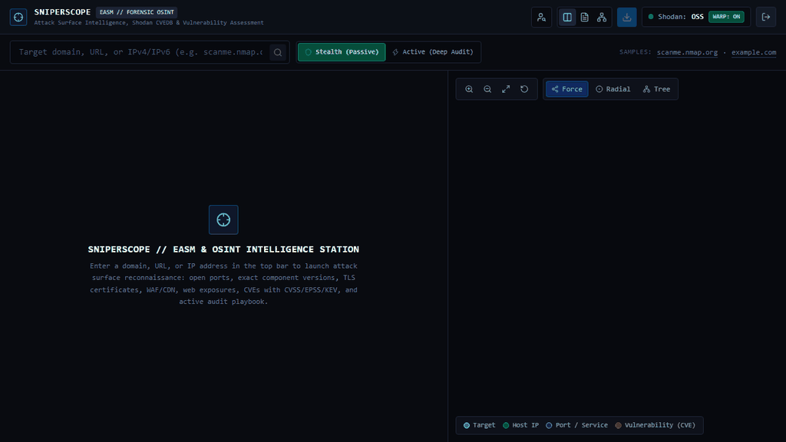
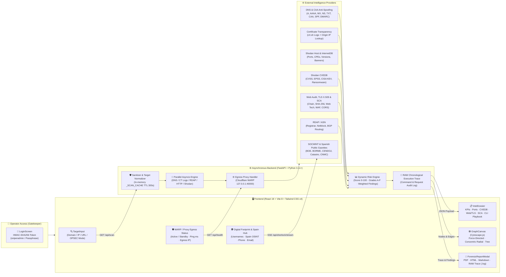

# 🎯 SniperScope v3.5 // Attack Surface Intelligence, Shodan CVEDB & Forensic EASM Platform

<p align="left">
  
  
  
  
  
  
  
  
</p>

<p align="center">
  
</p>

**SniperScope** is a high-performance **External Attack Surface Management (EASM)**, passive/active **OSINT intelligence**, and **forensic reporting workstation** designed for cybersecurity auditors, SOC analysts, and penetration testers.

From a single target (**domain name, full URL, or IPv4/IPv6 address**), SniperScope orchestrates multiple intelligence engines in parallel:
- Multi-record DNS zone enumeration with SPF/DMARC anti-spoofing and CAA issuer checking.
- SSL/TLS Certificate Transparency logs (crt.sh) with automatic *Origin IP* resolution.
- Official RDAP/WHOIS registry queries and BGP/ASN routing correlation.
- **Shodan Host API & InternetDB** for open ports, software versions, CPEs, and raw service banners.
- Deep vulnerability enrichment via **Shodan CVEDB** with real-time **CVSS v3/v2**, **EPSS exploitation probability**, **CISA KEV (Known Exploited Vulnerabilities)** status, and ransomware campaign associations.
- Live **TLS/SSL X.509 who.is-style crypto inspection** (cipher suite, public key bits, serial number, trust chain, validity window, SANs).
- Web uptime diagnosis, response latency, HTTP security headers, cookie flags (Secure, HttpOnly, SameSite), and CORS policies.
- **Software Composition Analysis (SCA)** web technology detection (heuristic component engine) mapping front/back components to known CVEs and PoCs.
- **Digital Footprint Suite & Spain OSINT Hub**: Real-time multi-platform username reconnaissance (400+ platforms via Server-Sent Events), phone forensics (CNMC Spain, spam DBs), email hunter (MX/SPF, Gravatar, breach dorks), and Spanish official gazettes and transparency registries.
- **39-Command Active CLI Playbook** mapped strictly to **OWASP Top 10: 2025** categories.
- Interactive **Anti-Collision Cytoscape.js Topological Graph** and multi-format **Forensic Report Exporter** (PDF, self-contained HTML, Markdown TLP:AMBER, and chronological RAW execution trace `.log`).

---

## 📐 Architecture & Data Flow



---

## 🎯 Core Use Cases

- 🛡️ **External Attack Surface Management (EASM):** Continuously monitor perimeter exposures, shadow IT, expiring TLS certificates, dangling subdomains, and unexpected listening ports across enterprise assets.
- 🎯 **Red Team & Penetration Testing Reconnaissance:** Conduct deep initial target enumeration without tripping client SOC alarms using **Stealth Mode**, then pivot to **Active Mode** with 39 pre-parametrized OWASP Top 10: 2025 commands.
- 🚨 **SOC & Incident Response Triage:** Rapidly determine if an alert involves assets with actively exploited vulnerabilities in the wild (CISA KEV) or ransomware weaponization tags.
- 🕵️ **OSINT & Identity Footprinting:** Correlate public usernames, domains, and corporate records across 400+ platforms and official public registries.

---

## 🛠️ Technology Stack

| Layer | Component | Implementation in SniperScope |
| :--- | :--- | :--- |
| **Frontend UI** | **React 19 + Vite 8** | High-density reactive Single Page Application with sub-millisecond local state transitions and LAN binding (`0.0.0.0`). |
| **Styling & Theme** | **Tailwind CSS v4 + Lucide React** | Dark forensic HUD aesthetic (`#07090e` / `#0f131c` / `#38bdf8`) with monospace technical typography and badge indicators. |
| **Topology Engine** | **Cytoscape.js** | Multi-layout interactive attack surface graph with collision avoidance: **Force-Directed (`cose`)**, **Concentric Radial (`concentric`)**, and **Hierarchical Tree (`breadthfirst`)**. |
| **Backend API** | **FastAPI + Uvicorn (Python 3.11+)** | High-concurrency asynchronous runtime (`asyncio`), input normalization, dynamic risk calculation, and real-time Server-Sent Events (SSE). |
| **Access Gatekeeper** | **Constant-Time HMAC-SHA256** | Secure operator authentication (`sniperadmin`) protecting the API endpoints across public or corporate networks. |
| **Outbound Transport** | **HTTPX / Optional Local Proxy** | Standard asynchronous HTTP client with optional support for routing queries through a local forward proxy (`127.0.0.1:40000`). |
| **HTTP, TLS & Uptime** | **HTTPX + Python `ssl` / `socket`** | Non-blocking TLS handshake inspection (X.509 chain, SHA-256 fingerprint, serial), response latency, meta-tags, and security headers. |
| **Technology Audit (SCA)** | **Regex & Signature Engine** | Heuristic detection of frontend/backend stacks (Astro, React, Vue, Next.js, WordPress, Nginx, Apache, etc.) correlated with known CVEs and PoCs. |
| **DNS & Anti-Spoofing** | **dnspython (`dns.resolver`)** | Comprehensive record enumeration (A, AAAA, MX, NS, TXT, CAA, SPF, DMARC) with automated email security diagnostics. |
| **Threat Intelligence** | **Shodan SDK + InternetDB + CVEDB** | Zero-packet host reconnaissance combined with CVE scoring: CVSS v3/v2, EPSS exploitation probability, CISA KEV status, and Ransomware tags. |

---

## 🔥 Key Capabilities

### 1. Dual OPSEC Scanning Profiles
- 🟢 **Passive / Stealth Mode (Default):** Zero active probe packets sent to the target's perimeter. All intelligence is gathered exclusively from third-party passive sources (Shodan, InternetDB, crt.sh, DNS resolvers, RDAP) and standard browser HTTP headers. Guaranteed stealth for threat hunting and legal reconnaissance.
- 🔴 **Authorized Active Mode:** Explicitly enabled by the operator when in scope. Executes targeted TCP/SSH banner grabbing (port 22 OS identification), deep library streaming version probes, sensitive path verification (`/.git/HEAD`, `/.env`, `/swagger.json`), and unlocks the comprehensive Active CLI Playbook.

### 2. Shodan CVEDB & Risk Scoring
- Cross-references discovered services and CPEs with Shodan CVEDB to extract full technical vulnerability summaries, CVSS scores, EPSS probabilities, and CISA KEV exploitation flags.
- **Dynamic Risk Score (0-100 & Grades A to F):** Calculates an objective security posture score based on critical CVEs, active ransomware associations, exposed credentials, missing security headers, and unauthenticated endpoints.

### 3. Software Composition Analysis (SCA)
- Discovers web components, CMS platforms, JavaScript libraries, and reverse proxies from DOM signatures and HTTP headers.
- Correlates outdated libraries (e.g., jQuery `< 3.5.0`, Bootstrap, Lodash, Apache HTTP Server, Nginx, PHP) directly with CVE identifiers, CVSS scores, remediation advice, and verified PoC / Exploit-DB links.

### 4. Digital Footprint Suite & Spain OSINT Hub
- **Username Digital Footprint Hunter:** Asynchronous real-time cross-platform scanner streaming over Server-Sent Events (SSE). Probes 400+ platforms organized into 10 categories (Coding & Dev, Social Media, Gaming, Tech, Finance, etc.).
- **Spain OSINT Hub:** Dedicated intelligence module for Spanish entities and citizens covering official gazettes and public registries:
  - **BOE** (Boletín Oficial del Estado)
  - **BORME** (Boletín Oficial del Registro Mercantil)
  - **CENDOJ** (Poder Judicial - Jurisprudencia)
  - **Sede del Catastro** (Inmuebles y Referencias Catastrales)
  - **PLACSP** (Plataforma de Contratación del Sector Público)
  - **DGT / BOE Tablón Edictal** (Sanciones y Notificaciones)
  - **CNMV** (Comisión Nacional del Mercado de Valores)
  - **INE** (Frecuencia de Apellidos y Nombres)
- **Phone Hunter:** International phone intelligence featuring CNMC Spain carrier routing, anti-spam database lookups (Listaspam), and PhoneInfoga dork generators.
- **Email Hunter:** Domain intelligence, MX/SPF checks, Gravatar avatar extraction, Epieos, Hunter.io, and breach query dorks.

### 5. 39-Command Active CLI Playbook (OWASP Top 10: 2025)
Parametrized, copy-to-clipboard commands pre-populated with discovered targets, IPs, and ports:
- **A01: Broken Access Control:** Nmap NSE auth checks, Nuclei access bypasses, Gobuster admin fuzzing.
- **A02: Cryptographic Failures:** Testssl.sh comprehensive cipher suites, OpenSSL cert verification, Nmap SSL enum.
- **A03: Injection:** Sqlmap automated SQLi, Commix OS command injection, Ghuri SSTI detection.
- **A04: Insecure Design:** Threat modeling heuristics, TruffleHog git secret hunting, Semgrep static analysis.
- **A05: Security Misconfiguration:** Nikto web scanner, Nuclei misconfig templates, Feroxbuster directory discovery.
- **A06: Vulnerable and Outdated Components:** Searchsploit local exploit database, Nuclei CVE scans, WPScan WordPress audit.
- **A07: Identification and Authentication Failures:** Hydra bruteforce, Nuclei default credentials, Hashcat cracking.
- **A08: Software and Data Integrity Failures:** Subresource Integrity (SRI) validation, dependency-check, pip-audit.
- **A09: Security Logging and Monitoring Failures:** WAF bypass testing, log injection verification, rate-limit probes.
- **A10: Server-Side Request Forgery (SSRF):** Interactsh OOB callback testing, SSRFmap automated payloads.

### 6. Anti-Collision Cytoscape Graph & Forensic Exporter
- Interactive topological map with dark semi-opaque badges, line wrapping, and high node repulsion (`45000`) preventing overlap.
- One-click exports:
  - **PDF Export** formatted for executive briefings.
  - **Self-Contained HTML** with embedded CSS and styling.
  - **Markdown (`.md`)** tagged `TLP:AMBER` for team handoffs.
  - **RAW Trace (`.log`)** containing the chronological step-by-step audit log of every command, HTTP request, and reasoning decision.

---

## 📂 Project Directory Structure

```text
desarrolloweb/
├── backend/
│   ├── main.py                      # FastAPI entrypoint, Gatekeeper Auth, Egress Proxy & RAW Trace
│   ├── requirements.txt             # Python dependencies (FastAPI, Shodan, HTTPX, dnspython, etc.)
│   ├── .env.example                 # Secure environment configuration template
│   ├── .env                         # Local environment variables (excluded from git)
│   └── services/                    # Core reconnaissance engines
│       ├── crtsh_scanner.py         # Certificate Transparency logs & origin IP resolution
│       ├── cve_enricher.py          # Shodan CVEDB (CVSS, EPSS, CISA KEV, Ransomware)
│       ├── dns_scanner.py           # Multi-record DNS resolution, SPF/DMARC & CAA checks
│       ├── email_osint.py           # Email intelligence, MX verification & breach dorks
│       ├── graph_builder.py         # Cytoscape.js topological graph constructor
│       ├── http_scanner.py          # TLS X.509, Uptime, Web Tech (SCA), WAF & cookie auditor
│       ├── phone_osint.py           # Phone forensics & Spanish CNMC carrier routing
│       ├── rdap_scanner.py          # RDAP registry queries & ASN netblock lookups
│       ├── sca_scanner.py           # Software Composition Analysis & component CVE mappings
│       ├── shodan_data.py           # Shodan API helpers & rate-limiting logic
│       ├── shodan_scanner.py        # Shodan Host API & InternetDB integration
│       ├── sherlock_data.py         # 400+ platforms catalog for username reconnaissance
│       └── sherlock_engine.py       # Asynchronous SSE stream scanner for SOCMINT
├── frontend/
│   ├── index.html                   # HTML5 application shell
│   ├── package.json                 # Node dependencies (React 19, Tailwind CSS v4, Cytoscape)
│   ├── vite.config.js               # Vite config, /api proxy forwarding, and LAN binding (0.0.0.0)
│   └── src/
│       ├── App.jsx                  # Main application state, views switcher, and session logic
│       ├── index.css                # Tailwind CSS v4 directives & theme tokens
│       ├── components/              # Modular UI components
│       │   ├── CveTable.jsx         # Vulnerability matrix with filters & CVSS/EPSS badges
│       │   ├── ForensicReportModal.jsx # Multi-format forensic report generator
│       │   ├── GraphCanvas.jsx      # Cytoscape topology canvas with multi-layout controls
│       │   ├── IntelDossier.jsx     # Technical intelligence dossier & OWASP CLI playbook
│       │   ├── LoginScreen.jsx      # Gatekeeper operator login & RoE disclaimer
│       │   ├── NodeDetails.jsx      # Node metadata inspector for the interactive graph
│       │   ├── SherlockView.jsx     # SOCMINT station, Spain OSINT Hub, Phone & Email Hunter
│       │   └── TargetInput.jsx      # Input sanitization, OPSEC profile toggle, and WARP status
│       └── services/api.js          # HTTP & SSE client communication layer
├── doc/                             # Technical documentation and specifications
│   ├── ARCHITECTURE_AND_FLOW.md     # In-depth architectural breakdown & data contracts
│   ├── BACKEND_REFERENCE.md         # API endpoint reference and JSON response schemas
│   └── FRONTEND_AND_UX.md           # Component architecture, styles, and Cytoscape configuration
├── start.bat                        # Windows Command Prompt automated launcher
└── start.ps1                        # Windows PowerShell automated launcher
```

---

## 🚀 3-Minute Quickstart (Easy Installation)

Get SniperScope up and running locally in under 3 minutes.

### Prerequisites
- **Python 3.11+**
- **Node.js 18+** & **npm**
- *(Optional)* **Shodan API Key** (for deep historical host queries; InternetDB and passive modules work without a key).

---

### Step 1: Clone & Configure Environment

```bash
git clone https://github.com/your-username/sniperscope.git
cd sniperscope
```

Copy the example environment configuration into `backend/.env`:

```bash
# Windows PowerShell
Copy-Item backend/.env.example backend/.env

# Linux / macOS
cp backend/.env.example backend/.env
```

Open `backend/.env` and define your secure operator credentials:

```env
# Shodan API Key (Optional but recommended)
SHODAN_API_KEY=your_shodan_api_key_here

# Local Outbound Proxy (Optional: Cloudflare WARP on port 40000)
OUTBOUND_PROXY=http://127.0.0.1:40000

# Operator Gatekeeper Credentials
SNIPERSCOPE_USER=sniperadmin
SNIPERSCOPE_PASS=YourSecurePassphrase2025!
```

---

### Step 2: Launch Application

#### ⚡ Option A: 1-Click Launch (Windows PowerShell)

Run the automated orchestrator from the project root:

```powershell
.\start.ps1
```
*(Or double-click `start.bat` from Windows File Explorer).*

This script automatically provisions `venv`, installs required Python packages, installs frontend `npm` dependencies, binds both servers to `0.0.0.0`, and opens your default browser at `http://localhost:5173`.

#### 🐧 Option B: Linux & macOS (Manual Setup)

Open two terminal tabs:

**Terminal 1 — Backend API (FastAPI):**
```bash
# 1. Create and activate virtual environment
python3 -m venv venv
source venv/bin/activate

# 2. Install backend dependencies
pip install -r backend/requirements.txt

# 3. Start FastAPI server on port 8000
python3 -m uvicorn backend.main:app --host 0.0.0.0 --port 8000
```

**Terminal 2 — Frontend UI (Vite / React 19):**
```bash
cd frontend
npm install
npm run dev -- --host 0.0.0.0
```

---

### Step 3: Access HUD & Start Reconnaissance

1. Open your browser and navigate to **`http://localhost:5173`** (or `http://<YOUR_LAN_IP>:5173` from your tablet or mobile device).
2. Authenticate using your credentials configured in `backend/.env` (default: `sniperadmin`).
3. Enter any target domain or IP (e.g., `scanme.nmap.org`, `1.1.1.1`) and press **Enter** to launch the parallel reconnaissance pipeline.
4. Access interactive OpenAPI documentation and Swagger UI at **`http://localhost:8000/docs`**.

---

## 🌐 Outbound Proxy Configuration (Optional)
SniperScope can optionally route its external HTTP queries through a local forward proxy (e.g. Cloudflare WARP client or standard HTTP/SOCKS5 proxy listening locally on port `40000`):
1. Configure your local proxy client in proxy mode on port `40000`:
   ```bash
   warp-cli mode proxy
   warp-cli set-proxy-port 40000
   warp-cli connect
   ```
2. When `OUTBOUND_PROXY=http://127.0.0.1:40000` is present in `backend/.env`, the backend detects the proxy, routing external queries through it and reporting link latency in the UI header. If unreachable, it falls back seamlessly to direct network transport.

---

## ⚖️ Rules of Engagement (RoE) & Legal Disclaimer

> [!CAUTION]
> **Authorized Use Only**: SniperScope is developed for authorized security assessments, penetration testing, defensive attack surface management, and lawful OSINT threat research. Testing targets without prior written consent is strictly illegal and violates computer fraud and misuse legislation worldwide.
>
> In **Passive / Stealth Mode**, the application performs strictly non-intrusive metadata gathering. However, the operator assumes full legal responsibility for any active probing initiated via the **Active Mode** or third-party CLI tools.

---

## 📄 License
This project is licensed under the **MIT License** - see the `LICENSE` file for details.
