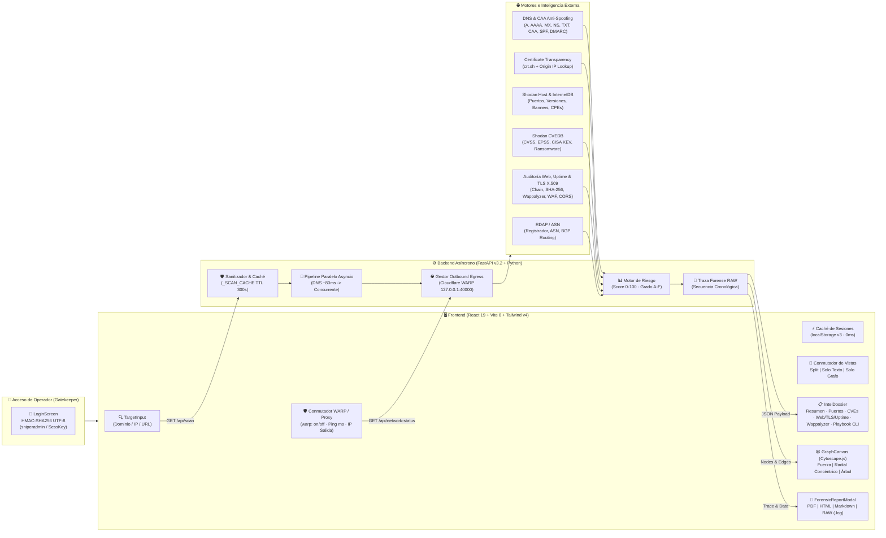

# 🎯 SniperScope v3.2 // Attack Surface Intelligence, Shodan CVEDB & Forensic EASM

<p align="left">
  
  
  
  
  
  
  
</p>

**SniperScope** es una estación de trabajo web de **Gestión de Superficie de Ataque Externa (EASM)**, reconocimiento **OSINT** pasivo/activo y generación de informes de **análisis forense** diseñada para auditores de ciberseguridad, analistas SOC y pentesters.

A partir de un único objetivo (**dominio, URL o dirección IPv4/IPv6**), **SniperScope** orquesta en paralelo múltiples motores de inteligencia (resolución DNS multi-registro, Certificate Transparency logs con descubrimiento de *Origin IPs*, registros RDAP/ASN, **Shodan Official API / InternetDB**, enriquecimiento profundo en **Shodan CVEDB** con métricas **CVSS / EPSS / CISA KEV / Ransomware**, e inspección en vivo de **TLS/SSL X.509 estilo who.is con comprobación DNS CAA, Uptime & Server info, motor Wappalyzer, WAF/CDN, cabeceras HTTP, cookies, políticas CORS y rutas sensibles expuestas**), unificando los hallazgos en un **Dossier Forense en Texto** y un **Grafo Topológico Interactivo Anti-Colisión**.

---

## 📐 Esquema Visual de Arquitectura y Flujo de Datos



---

## 🛠️ Stack Tecnológico

| Capa | Tecnología | Propósito en SniperScope |
| :--- | :--- | :--- |
| **Frontend UI** | **React 19 + Vite 8** | Interfaz SPA reactiva de baja latencia con proxy inverso integrado (`/api`) y enlace LAN (`0.0.0.0`). |
| **Estilos & Diseño** | **Tailwind CSS v4 + Lucide React** | Estética técnica de alta densidad en modo oscuro (`#07090e` / `#0f131c` / `#38bdf8`) con feedback háptico y visual. |
| **Visualización Topológica** | **Cytoscape.js (Multi-Layout)** | Grafo de superficie de ataque anti-colisión con selector de modo: **Fuerza física (`cose`)**, **Radial (`concentric`)** y **Árbol (`breadthfirst`)**. |
| **Backend API** | **FastAPI + Uvicorn (Python 3.11+)** | Orquestación asíncrona no bloqueante (`asyncio`), validación de objetivos, cálculo de riesgo y trazas forenses. |
| **Seguridad de Acceso** | **HMAC-SHA256 en tiempo constante** | Autenticación previa de Operador (`sniperadmin`) para proteger el uso de la API en redes abiertas o servidores remotos. |
| **Anonimización Egress** | **Cloudflare WARP (Modo Proxy) / HTTPX** | Enrutamiento de peticiones salientes a través de proxy local (`127.0.0.1:40000`) ocultando la IP residencial o del auditor. |
| **Cliente HTTP, TLS & Uptime** | **HTTPX + Python `ssl` / `socket`** | Peticiones asíncronas con inspección X.509 (cadena, serial, SHA-256 fingerprint), latencia ms, título y meta-tags. |
| **Detección de Tecnologías** | **Motor Regex Anti Falsos-Positivos** | Identificación de Astro, Tailwind CSS, Vue, Angular, React, WordPress, jQuery, Nginx, etc. con versión detectada. |
| **Resolución DNS & CAA** | **dnspython (`dns.resolver`)** | Enumeración de registros DNS (A, AAAA, MX, NS, TXT, CAA, SPF, DMARC) y comprobación de políticas de emisión SSL. |
| **Inteligencia de Amenazas** | **Shodan SDK + InternetDB + CVEDB** | Descubrimiento de puertos/banners pasivos y enriquecimiento de CVEs con CVSS, EPSS, CISA KEV y campañas de Ransomware. |

---

## 🔥 Funcionalidades Principales

1. **Control de Acceso de Operador (Gatekeeper):**
   - Pantalla de inicio de sesión con validación de credenciales (`sniperadmin`), persistencia en `sessionStorage` y cierre de sesión seguro.
2. **Anonimización y Gestión de Proxy Saliente (Cloudflare WARP):**
   - Indicador dinámico en la cabecera: `warp: on / off`, latencia de sondeo en milisegundos y visualización de la IP pública de salida efectiva.
3. **Reconocimiento de Infraestructura y Banners (Shodan Híbrido):**
   - Desglose de cada IP activa, organización propietaria, ISP, ASN (con hiperenlaces verificados a `ipinfo.io` y `bgp.he.net`), sistema operativo inferido, puertos TCP/UDP abiertos y banners crudos.
4. **Inteligencia Profunda de Vulnerabilidades (Shodan CVEDB):**
   - Puntuación **CVSS v3/v2**, probabilidad de explotación **EPSS**, presencia en el catálogo **CISA KEV** (*Known Exploited Vulnerabilities*) y alertas de asociación a familias de **Ransomware**.
5. **Inspección TLS/SSL y Diagnóstico de Uptime (Estilo who.is):**
   - Criptografía X.509 completa: Algoritmo de clave pública (ej. EC 256-bit, RSA 2048-bit), huella SHA-256, número de serie, cadena de confianza (Root CA e Intermedias), SANs y verificación de directivas CAA en DNS.
   - Estado activo, latencia de respuesta, banner de servidor, `<title>` de página, meta-description y meta-keywords en tiempo real.
6. **Motor de Detección de Tecnologías (Estilo Wappalyzer):**
   - Identificación de frameworks modernos y librerías sin falsos positivos en español, categorizados con insignias visuales y versiones.
7. **Playbook CLI:**
   - Comandos parametrizados listos para copiar con la IP, dominio y puertos abiertos descubiertos, divididos estrictamente en:
     - **🟢 MODO STEALTH (Reconocimiento Pasivo / Bajo Ruido):** Comandos no intrusivos (`whois`, `dig`, `curl -I`, `openssl s_client`, `subfinder`, `nmap -sS -T2 -f -D RND:5`) que evitan generar alertas en IDS/WAF.
     - **🔴 MODO ACTIVO (Auditoría Intrusiva Autorizada):** Comandos de sondeo profundo (`nmap -sV -sC`, `masscan`, `nuclei`, `nikto`, `feroxbuster`, `gobuster`, `ffuf`, `wpscan`, `testssl.sh`).
8. **Grafo Topológico Cytoscape Anti-Colisión:**
   - Visualización de la superficie de ataque con etiquetas compactas (`:3389/tcp RDP`), ajuste de línea (`text-wrap`), pastillas de fondo oscuras semiopacas y tres modos de distribución: **Fuerza** (`cose` con repulsión ampliada `45000`), **Radial** (`concentric` concéntrico sin solapamientos) y **Árbol** (`breadthfirst`).
9. **Exportador de Informes Forenses (4 Formatos):**
   - Impresión directa a **PDF**, exportación **HTML Autocontenido**, **Markdown (`.md`)** clasificado `TLP:AMBER` y traza forense cronológica paso a paso **RAW (`.log`)**.

---

## 📂 Estructura del Proyecto

```text
desarrolloweb/
├── backend/
│   ├── main.py                      # API FastAPI v3.2, Autenticación, Proxy Egress y Trazas RAW
│   ├── requirements.txt             # Dependencias Python
│   ├── .env.example                 # Plantilla de variables de entorno segura
│   ├── .env                         # Variables de entorno locales (excluido en git)
│   └── services/                    # Motores de reconocimiento
│       ├── crtsh_scanner.py         # Certificate Transparency y subdominios
│       ├── cve_enricher.py          # Enriquecimiento CVSS, EPSS, CISA KEV, Ransomware
│       ├── dns_scanner.py           # Resolución DNS multi-registro y verificación CAA
│       ├── graph_builder.py         # Constructor del grafo con etiquetas compactas
│       ├── http_scanner.py          # TLS X.509, Uptime, Wappalyzer, WAF y cabeceras
│       ├── rdap_scanner.py          # Consultas RDAP y enriquecimiento ASN
│       └── shodan_scanner.py        # Shodan Host API e InternetDB
├── frontend/
│   ├── public/favicon.svg           # Icono vectorial SniperScope
│   ├── index.html                   # HTML5 Shell
│   ├── vite.config.js               # Configuración Vite, Proxy /api y enlace 0.0.0.0
│   └── src/
│       ├── App.jsx                  # Estado global, enrutamiento y sesión
│       ├── components/              # LoginScreen, TargetInput, IntelDossier, GraphCanvas, etc.
│       └── services/api.js          # Cliente HTTP hacia la API FastAPI
├── doc/                             # 📚 Documentación Técnica Detallada
│   ├── ARCHITECTURE_AND_FLOW.md     # Flujos de datos, secuencia paralela y fórmula de riesgo
│   ├── BACKEND_REFERENCE.md         # Referencia exhaustiva de endpoints y modelos
│   └── FRONTEND_AND_UX.md           # Componentes UI, Cytoscape y exportador
├── start.bat                        # Lanzador automático en Windows (CMD)
└── start.ps1                        # Lanzador automático en Windows (PowerShell)
```

---

## 🚀 Puesta en Marcha y Acceso

### 1. Configuración de Entorno
Crea o edita el archivo `backend/.env` basándote en `backend/.env.example`:
```env
SHODAN_API_KEY=tu_api_key_de_shodan_aqui
OUTBOUND_PROXY=http://127.0.0.1:40000
SNIPERSCOPE_USER=sniperadmin
SNIPERSCOPE_PASS=tu_contraseña_robusta_aqui
```

### 2. Inicio Rápido (Windows)
Desde la raíz del proyecto:
```powershell
.\start.ps1
```
O con el script por lotes:
```cmd
start.bat
```

### 3. Puntos de Conexión
- **Frontend Web:** `http://localhost:5173` (o `http://<IP_LOCAL>:5173` para acceso desde otros equipos en la LAN).
- **Documentación OpenAPI (Swagger):** `http://localhost:8000/docs`
- **Credenciales por defecto:** Usuario: `sniperadmin` (Contraseña definida en `SNIPERSCOPE_PASS`).
