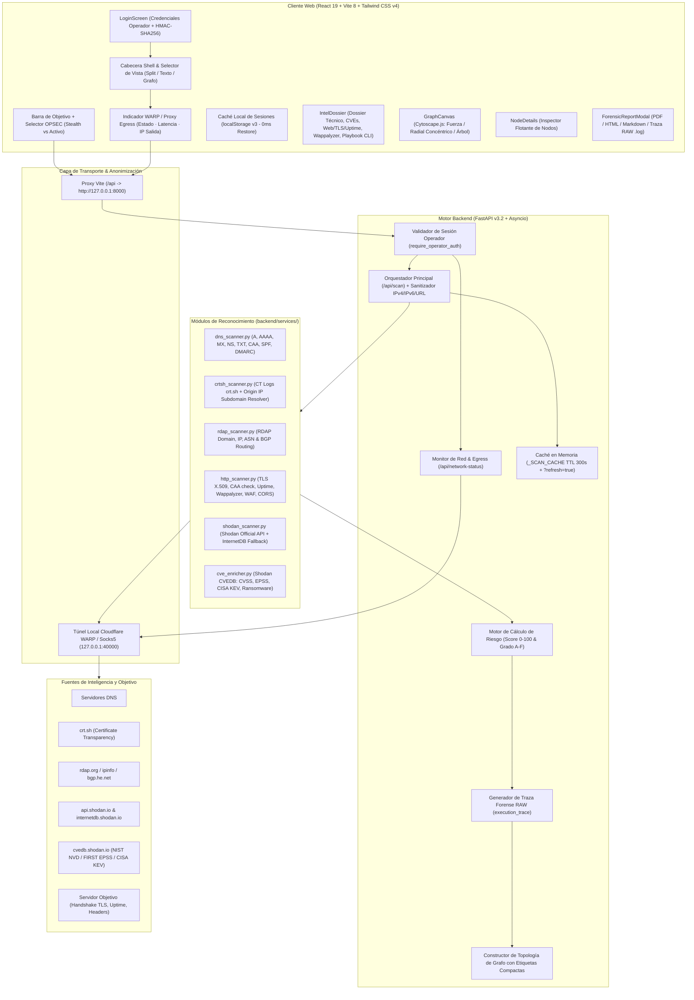

# SniperScope v3.2 // Arquitectura del Sistema y Flujo de Ejecución

Este documento describe la arquitectura técnica de **SniperScope**, el flujo de ejecución de su motor asíncrono de reconocimiento de superficie de ataque (EASM / OSINT), el túnel de anonimización de salida y el modelo matemático de evaluación de riesgo.

---

## 1. Esquema General de Arquitectura

**SniperScope** sigue una arquitectura desacoplada **Cliente-Servidor** diseñada para operar tanto en estación local (`localhost`) como en red local (`0.0.0.0:5173` / `0.0.0.0:8000`) mediante el proxy inverso de Vite hacia el motor FastAPI.

---

## 2. Flujo de Ejecución del Pipeline Concurrente

Cuando el usuario solicita un reconocimiento (`/api/scan?target=...&mode=passive|active`):

1. **Autenticación:** Se comprueba el token de sesión del operador mediante cabecera `X-Operator-Token` validada con HMAC-SHA256.
2. **Sanitización:** Se extrae el hostname/IP limpio, eliminando protocolos (`http://`, `https://`) y rutas.
3. **Resolución DNS & CAA (~80 ms):** `dns_scanner.py` obtiene registros A, AAAA, MX, NS, TXT, CAA, SPF y DMARC.
4. **Disparo en Paralelo (`asyncio.gather`):**
   - `shodan_scanner.py`: Consulta de puertos, banners y versiones pasivas.
   - `crtsh_scanner.py`: Extracción de subdominios y resolución de posibles *Origin IPs*.
   - `http_scanner.py`: Inspección de TLS (algoritmo, serial, fingerprint SHA-256, CA chain), verificación cruzada con registros CAA, uptime & server info, y motor Wappalyzer. En modo activo, sondea rutas de configuración expuestas (`/.env`, `/.git/HEAD`).
   - `rdap_scanner.py`: Consulta de asignación de IP, ASN y enlaces BGP.
5. **Enriquecimiento de Vulnerabilidades:** Cada CVE reportado por Shodan se consulta contra **Shodan CVEDB** para obtener CVSS v3/v2, probabilidad EPSS, pertenencia a CISA KEV y vínculos con Ransomware.
6. **Cálculo de Riesgo y Traza RAW:** El motor pondera todos los hallazgos y genera el JSON final junto con la topología para Cytoscape.js.

---

## 3. Modos OPSEC: Stealth (Pasivo) vs Activo

| Característica | Modo Stealth (Pasivo) | Modo Activo (Autorizado) |
| :--- | :--- | :--- |
| **Sondeo Web** | GET raíz estándar con User-Agent de navegador moderno | GET raíz + sondeo de `/.env`, `/.git/HEAD`, `/swagger.json` |
| **Puertos y Servicios** | 100% Pasivo (Shodan API / InternetDB / CT Logs) | Pasivo + Comandos listos en el Playbook Activo |
| **Alerta en IDS/WAF** | Nula / Mínima | Potencial (requiere autorización contractual) |
| **Rastro en Logs** | Huella de navegación común | Peticiones identificables a rutas sensibles |
