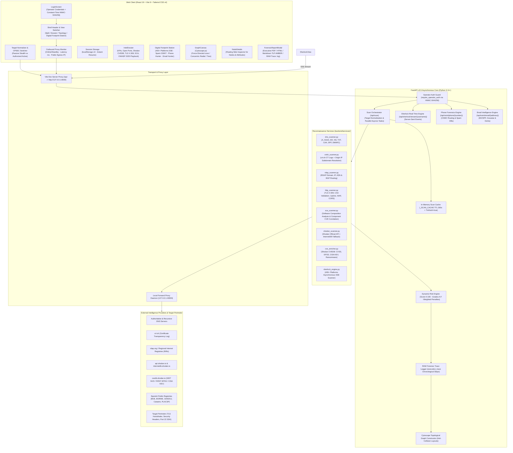
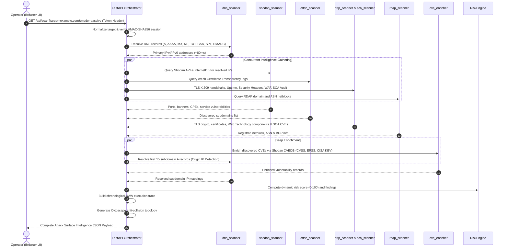

# SniperScope v3.5 // System Architecture & Execution Flow

This document details the technical architecture of **SniperScope**, the execution flow of its concurrent asynchronous attack surface intelligence engine (EASM / OSINT), its real-time Server-Sent Events (SSE) streaming pipelines, optional outbound proxy transport, and the mathematical risk scoring model.

---

## 1. High-Level System Architecture

**SniperScope** implements a decoupled **Client-Server** architecture engineered for low-latency local execution (`localhost`) and network-wide LAN deployments (`0.0.0.0:5173` / `0.0.0.0:8000`) utilizing Vite's reverse proxy forwarding directly to FastAPI.

---

## 2. Parallel Asynchronous Reconnaissance Pipeline

When an operator triggers a scan request (`GET /api/scan?target=...&mode=passive|active`), the backend initiates an asynchronous pipeline designed to minimize wall-clock latency:

---

## 3. Sherlock SOCMINT & Spanish Public Registries Pipeline

The Sherlock reconnaissance workstation operates independently via **Server-Sent Events (SSE)**, streaming live target findings without blocking the user interface:

1. **Username SOCMINT Scanner (`/api/sherlock/stream/{username}`):**
   - Dispatches non-blocking HTTP probes across 400+ platforms across 10 categories (Coding, Social, Tech, Gaming, Finance, etc.).
   - Implements custom status code, redirect, and error-text validation to eliminate false positives.
   - Emits structured SSE events: `init`, `progress` (checked/found metrics), and `complete`.
2. **Spain OSINT Hub:**
   - Dedicated investigative hub targeting official gazettes and public administration databases:
     - **BOE** (Boletín Oficial del Estado)
     - **BORME** (Boletín Oficial del Registro Mercantil)
     - **CENDOJ** (Poder Judicial - Jurisprudencia)
     - **Sede Electrónica del Catastro**
     - **PLACSP** (Plataforma de Contratación del Sector Público)
     - **DGT** (Sanciones y distintivo ambiental)
     - **CNMV** (Comisión Nacional del Mercado de Valores)
     - **INE** (Frecuencia de apellidos y nombres)
3. **Phone Hunter (`/api/osint/phone/{number}`):**
   - International E.164 normalization, carrier routing allocation, line classification (Mobile, Fixed, VoIP), and live anti-spam reputation scoring.
4. **Email Hunter (`/api/osint/email/{address}`):**
   - Domain parsing, MX record validation, SPF/DMARC anti-spoofing audit, passive SMTP mailbox verification, live account probing, and data breach cross-referencing.

---

## 4. OPSEC Modes: Passive Stealth vs Authorized Active

| Capability | Passive / Stealth Mode (Default) | Authorized Active Mode |
| :--- | :--- | :--- |
| **Target Perimeter Probing** | **Zero packets sent to target perimeter** (100% third-party intelligence) | Targeted non-destructive active probes |
| **Web Header Inspection** | Standard root `GET /` with modern browser User-Agent | Root `GET /` + CORS Origin probing |
| **Sensitive Path Probes** | Strictly forbidden (`/.env`, `/.git/` are never queried) | Active verification of `/.git/HEAD`, `/.env`, `/swagger.json`, `/robots.txt`, `/.well-known/security.txt` |
| **SSH / Banner Grabbing** | Only passive banners retrieved via Shodan/InternetDB | Direct raw TCP socket probe to port 22 SSH to fingerprint Linux OS and package revisions |
| **Technology Versions** | Passive HTML/DOM regex and static asset URL inspection | Deep streaming Range header probes for unversioned JavaScript libraries |
| **Active CLI Playbook** | Read-only guidance | Complete 39-command playbook mapped to **OWASP Top 10: 2025** |
| **IDS / WAF Detection Risk** | None / Negligible | Low to Moderate (Strictly for authorized audit engagements) |

---

## 5. Mathematical Risk Evaluation Model

The **Risk Engine** computes a deterministic security posture score ($0 \le S \le 100$) and assigns a letter grade based on observed security weaknesses:

$$\text{Risk Score} = \min\left(100, \sum P_i\right)$$

### Penalty Weights ($P_i$)

| Condition | Penalty ($P_i$) | Severity Level |
| :--- | :---: | :---: |
| Critical exposed file path (`/.git/HEAD` or `/.env`) | $+40$ | CRITICAL |
| CISA KEV Known Exploited Vulnerabilities ($N \ge 1$) | $+35$ | CRITICAL |
| Vulnerability with active Ransomware campaign correlation | $+30$ | CRITICAL |
| Critical Severity CVEs ($\text{CVSS} \ge 9.0$) | $+25$ | CRITICAL |
| Database / Management port exposed to public Internet (3306, 5432, 27017, 6379, 3389, 23, 445) | $+20$ | HIGH |
| High Severity CVEs ($7.0 \le \text{CVSS} \le 8.9$) | $+15$ | HIGH |
| High EPSS Exploitation Probability ($\text{EPSS} \ge 20\%$) | $+15$ | HIGH |
| Missing SPF or DMARC Anti-Spoofing Records | $+10$ | MEDIUM |
| Missing Critical HTTP Security Headers ($\ge 3$ missing from HSTS, CSP, XFO, etc.) | $+8$ | MEDIUM |
| Insecure Cookie Flags (Missing `Secure` or `HttpOnly`) | $+8$ | MEDIUM |
| Medium Severity CVEs ($4.0 \le \text{CVSS} \le 6.9$) | $+8$ | MEDIUM |
| Low Severity CVEs ($\text{CVSS} < 4.0$) | $+3$ | LOW |

### Grade Mapping Scale

$$\text{Grade} = \begin{cases}
\mathbf{A} & \text{if } S < 15 \quad (\text{Optimal posture}) \\
\mathbf{B} & \text{if } 15 \le S < 30 \quad (\text{Low risk}) \\
\mathbf{C} & \text{if } 30 \le S < 50 \quad (\text{Moderate risk}) \\
\mathbf{D} & \text{if } 50 \le S < 75 \quad (\text{High risk}) \\
\mathbf{F} & \text{if } S \ge 75 \quad (\text{Critical compromise risk})
\end{cases}$$
