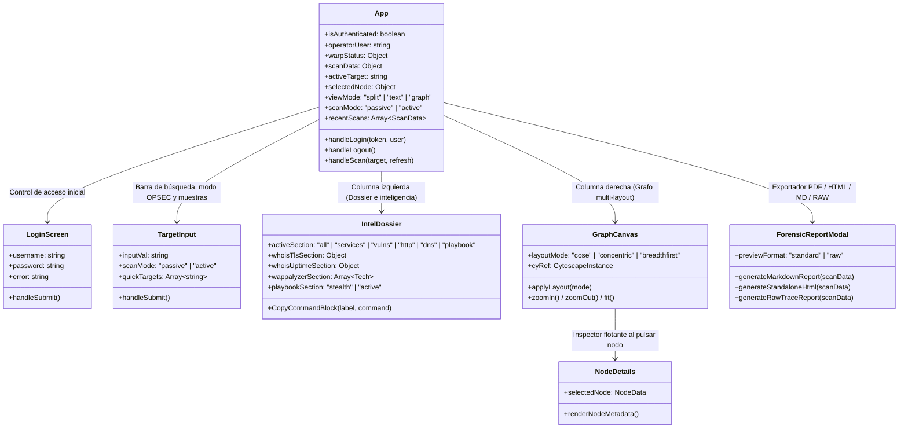

# SniperScope v3.2 // Arquitectura Frontend, Componentes y Experiencia de Auditoría

El frontend de **SniperScope** está desarrollado con **React 19**, **Vite 8**, **Tailwind CSS v4**, **Cytoscape.js** y **Lucide Icons**, aplicando los principios de diseño de **Taste Skill (`design-taste-frontend`)**: estética oscura de alta precisión (`#07090e` / `#0f131c`), tipografía monoespaciada técnica para indicadores forenses y cero ruido visual.

---

## 1. Árbol de Componentes y Responsabilidades

---

## 2. Flujo de Interacción y Características Clave

### 2.1. Puerta de Acceso del Operador ([`LoginScreen.jsx`](file:///c:/Users/kiike/desarrolloweb/frontend/src/components/LoginScreen.jsx))
- Protege la aplicación frente a usos no autorizados en entornos de red abierta o despliegues remotos.
- Valida credenciales contra el backend (`/api/login`) mediante HMAC-SHA256, almacena el token en `sessionStorage` y ofrece un botón de desconexión rápida (`Cerrar Sesión`) en la cabecera.

### 2.2. Cabecera, Conmutador de Vistas e Indicador WARP ([`App.jsx`](file:///c:/Users/kiike/desarrolloweb/frontend/src/App.jsx))
- **Monitor de Egress (WARP):** Monitoriza en vivo la salida de red (`warp: on / off`, latencia en ms e IP pública de salida).
- **Conmutador de Vistas (Icon-Only):**
  1. **Vista Dividida (`Columns`):** Dossier técnico a la izquierda (57%) + Grafo interactivo a la derecha (43%).
  2. **Solo Texto (`FileText`):** Dossier a pantalla completa (100%).
  3. **Solo Grafo (`Network`):** Topología Cytoscape a pantalla completa.

### 2.3. Barra de Búsqueda y Selector OPSEC ([`TargetInput.jsx`](file:///c:/Users/kiike/desarrolloweb/frontend/src/components/TargetInput.jsx))
- Permite seleccionar entre:
  - **🟢 Stealth (Pasivo):** Sin sondeo de rutas sensibles, cero ruido y User-Agent de navegador habitual.
  - **🔴 Activo (Rutas):** Auditoría activa de rutas (`/.env`, `/.git/HEAD`, `/swagger.json`) para entornos autorizados.

### 2.4. Dossier de Inteligencia ([`IntelDossier.jsx`](file:///c:/Users/kiike/desarrolloweb/frontend/src/components/IntelDossier.jsx))
- **Métricas de Infraestructura y BGP:** Hiperenlaces directos y verificados hacia `ipinfo.io/AS...` y `bgp.he.net/AS...` para inspección de peering y prefijos enrutados.
- **Inspección TLS X.509 y Uptime Estilo who.is:** Tarjeta técnica con algoritmo de clave pública, fingerprint SHA-256, número de serie, cadena de confianza CA, verificación DNS CAA, latencia ms, banner y meta-tags.
- **Motor Wappalyzer:** Detección de tecnologías y versiones con insignias de categoría.
- **Playbook CLI:** Comandos parametrizados con botón de copiado con un clic, separados de forma explícita en:
  - **MODO STEALTH:** Acciones de bajo ruido (`whois`, `dig`, `curl -I`, `openssl`, `subfinder`, `nmap -sS -T2 -f -D RND:5`).
  - **MODO ACTIVO:** Acciones intrusivas de penetración (`nmap -sV -sC`, `masscan`, `nuclei`, `nikto`, `feroxbuster`, `gobuster`, `ffuf`, `wpscan`).

### 2.5. Grafo Cytoscape Anti-Colisión ([`GraphCanvas.jsx`](file:///c:/Users/kiike/desarrolloweb/frontend/src/components/GraphCanvas.jsx))
- **Etiquetas Compactas y Legibilidad:** Salto de línea (`text-wrap: wrap`, max-width `110px`) y pastillas de fondo semiopacas (`#07090e`, opacidad 0.88) que impiden interferencias con las aristas.
- **Selector de Disposición en la Barra Superior:**
  - **Fuerza (`cose`):** Repulsión física multiplicada (`nodeRepulsion: 45000`) y longitud de enlace amplia (`140px`).
  - **Radial (`concentric`):** Distribución matemática concéntrica (Target en núcleo, IPs en anillo 1, Subdominios en anillo 2, Puertos en anillo 3) con **cero solapamiento garantizado**.
  - **Árbol (`breadthfirst`):** Disposición jerárquica dirigida.
