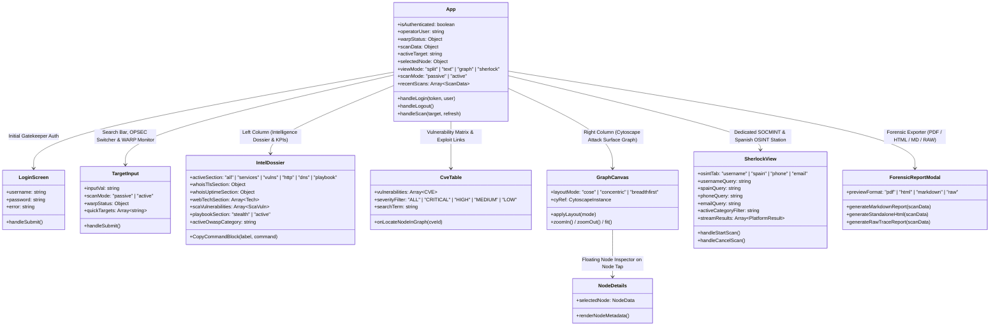

# SniperScope v3.5 // Frontend Architecture, UI Components & Forensic UX

The **SniperScope** frontend is engineered with **React 19**, **Vite 8**, **Tailwind CSS v4**, **Cytoscape.js**, and **Lucide Icons**, delivering a high-density dark forensic interface (`#07090e` / `#0c1017` / `#1e2638`) with zero visual latency.

---

## 1. Component Hierarchy & State Flow

---

## 2. Core UI Components Specification

### 2.1. Operator Gatekeeper ([`LoginScreen.jsx`](file:///c:/Users/kiike/desarrolloweb/frontend/src/components/LoginScreen.jsx))
- Safeguards platform access across open networks, team LANs, or remote servers.
- Authenticates against `/api/auth/login` via constant-time HMAC-SHA256, stores the signed token in `localStorage`, and provides a one-click session termination button in the shell header.
- Displays explicit **Rules of Engagement (RoE)** and legal disclaimers.

### 2.2. Shell Header & View Switcher ([`App.jsx`](file:///c:/Users/kiike/desarrolloweb/frontend/src/App.jsx))
- **Outbound Proxy Status Monitor:** Real-time poll of outbound proxy reachability (`warp: on / auto`, link latency in ms).
- **View Mode Switcher:**
  1. **Split View (`Columns`):** Technical Dossier on the left (57%) + Cytoscape Graph on the right (43%).
  2. **Dossier Fullscreen (`FileText`):** High-density text intelligence dossier (100% width).
  3. **Topology Fullscreen (`Network`):** Interactive Cytoscape attack surface canvas (100% width).
  4. **Sherlock Station (`UserSearch`):** Switches context into the multi-tab SOCMINT and public registry workspace.

### 2.3. Target Input & OPSEC Switcher ([`TargetInput.jsx`](file:///c:/Users/kiike/desarrolloweb/frontend/src/components/TargetInput.jsx))
- Sanitizes domains, full URLs, and IPv4/IPv6 addresses on submit.
- **OPSEC Profile Toggle:**
  - 🟢 **Passive / Stealth:** Zero active probes to target perimeter; standard browser User-Agent.
  - 🔴 **Authorized Active:** Unlocks active path scanning (`/.git/HEAD`, `/.env`, `/swagger.json`) and the 39-command CLI playbook.

### 2.4. Technical Intelligence Dossier ([`IntelDossier.jsx`](file:///c:/Users/kiike/desarrolloweb/frontend/src/components/IntelDossier.jsx))
- **KPI Metrics Cards:** Risk Score (0-100 & Grades A-F), Discovered Subdomains, Open Ports count, Total CVEs, and CISA KEV Exploited indicators.
- **Infrastructure & BGP:** Direct verified hyperlinks to `ipinfo.io/AS...` and `bgp.he.net/AS...` for ASN peering lookups.
- **who.is-Style TLS/SSL & Uptime Audit:** Complete X.509 cryptographic analysis (protocol version, cipher suite, public key bits, serial number, SHA-256 fingerprint, CA trust chain, and DNS CAA validation).
- **Software Composition Analysis (SCA):** Web Technology-detected client and web components correlated with known CVEs, severity ratings, and PoC/Exploit-DB links.
- **Security Headers & Cookies:** Real-time audit of HSTS, CSP, XFO, CORS, and cookie flags (`Secure`, `HttpOnly`, `SameSite`).
- **39-Command Active CLI Playbook (OWASP Top 10: 2025):** Parameterized commands pre-populated with target IPs and ports, structured across all 10 OWASP 2025 categories:
  - **A01: Broken Access Control** (`nmap`, `nuclei`, `gobuster`)
  - **A02: Cryptographic Failures** (`testssl.sh`, `openssl`, `nmap --script ssl-enum-ciphers`)
  - **A03: Injection** (`sqlmap`, `commix`, `ghuri`)
  - **A04: Insecure Design** (`trufflehog`, `semgrep`, `gitleaks`)
  - **A05: Security Misconfiguration** (`nikto`, `nuclei`, `feroxbuster`)
  - **A06: Vulnerable and Outdated Components** (`searchsploit`, `nuclei`, `wpscan`)
  - **A07: Identification and Authentication Failures** (`hydra`, `nuclei`, `hashcat`)
  - **A08: Software and Data Integrity Failures** (`dependency-check`, `pip-audit`, `sri-hash`)
  - **A09: Security Logging and Monitoring Failures** (`wafw00f`, `log-fuzzer`)
  - **A10: Server-Side Request Forgery (SSRF)** (`interactsh-client`, `ssrfmap`)

### 2.5. Vulnerability Matrix ([`CveTable.jsx`](file:///c:/Users/kiike/desarrolloweb/frontend/src/components/CveTable.jsx))
- High-density table featuring real-time filters by severity (CRITICAL, HIGH, MEDIUM, LOW) and search keywords.
- Displays CVSS v3 score badges, EPSS exploitation probability percentages, CISA KEV badges, and Ransomware tags.
- Features a **"Focus in Graph"** button that centers the corresponding CVE node in the Cytoscape canvas with an animation pulse.

### 2.6. Topological Canvas ([`GraphCanvas.jsx`](file:///c:/Users/kiike/desarrolloweb/frontend/src/components/GraphCanvas.jsx))
- Anti-collision Cytoscape.js engine with dark semi-opaque pill backgrounds and line-wrapped compact labels (`:443/tcp Nginx`).
- **Three Layout Distribution Modes:**
  1. **Force-Directed (`cose`):** High repulsion physics (`nodeRepulsion: 45000`) preventing overlapping nodes.
  2. **Concentric Radial (`concentric`):** Concentric rings radiating outward from the root target to IPs, ports, and CVEs.
  3. **Hierarchical Tree (`breadthfirst`):** Top-down directory tree layout.

### 2.7. Node Inspector ([`NodeDetails.jsx`](file:///c:/Users/kiike/desarrolloweb/frontend/src/components/NodeDetails.jsx))
- Sliding forensic inspector appearing upon selecting any graph node (`target`, `ip`, `subdomain`, `port`, `cve`).
- Displays raw metadata, banner contents, TLS certificate chains, and vulnerability summaries.

### 2.8. Sherlock SOCMINT & Public OSINT Station ([`SherlockView.jsx`](file:///c:/Users/kiike/desarrolloweb/frontend/src/components/SherlockView.jsx))
- **Tab 1: Username SOCMINT Hunter:** Streams live results from 400+ platforms over Server-Sent Events (SSE) with category filters (Coding & Dev, Social Media, Gaming, Tech, Finance, etc.).
- **Tab 2: Spain OSINT Hub:** Direct investigative lookups across official Spanish gazettes and public registries:
  - **BOE** (Boletín Oficial del Estado)
  - **BORME** (Boletín Oficial del Registro Mercantil)
  - **CENDOJ** (Poder Judicial - Jurisprudencia)
  - **Sede Electrónica del Catastro**
  - **PLACSP** (Plataforma de Contratación del Sector Público)
  - **DGT** (Sanciones y Distintivo Ambiental)
  - **CNMV** (Comisión Nacional del Mercado de Valores)
  - **INE** (Frecuencia de Apellidos y Nombres)
  - Specialized Google Hacking Dorks for Spanish public administration.
- **Tab 3: Phone Hunter:** International phone normalization, Spanish CNMC operator block allocation, Listaspam reputation checks, and PhoneInfoga dork queries.
- **Tab 4: Email Hunter:** Domain extraction, MX/SPF checks, Gravatar avatar discovery, and breach search queries (Epieos, Hunter.io, Hudson Rock).

### 2.9. Forensic Report Generator ([`ForensicReportModal.jsx`](file:///c:/Users/kiike/desarrolloweb/frontend/src/components/ForensicReportModal.jsx))
- Generates 4 compliant forensic export formats with a single click:
  1. **Executive PDF:** Formatted for C-level executive briefings with risk scoring and charts.
  2. **Standalone HTML:** Self-contained single-file HTML report with embedded CSS styling.
  3. **Markdown (`.md`):** Formatted report tagged `TLP:AMBER` for red team handoffs.
  4. **RAW Execution Trace (`.log`):** Chronological step-by-step audit log of every command, HTTP request, and reasoning decision made by the system.
